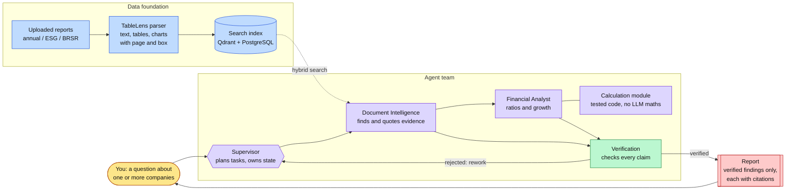
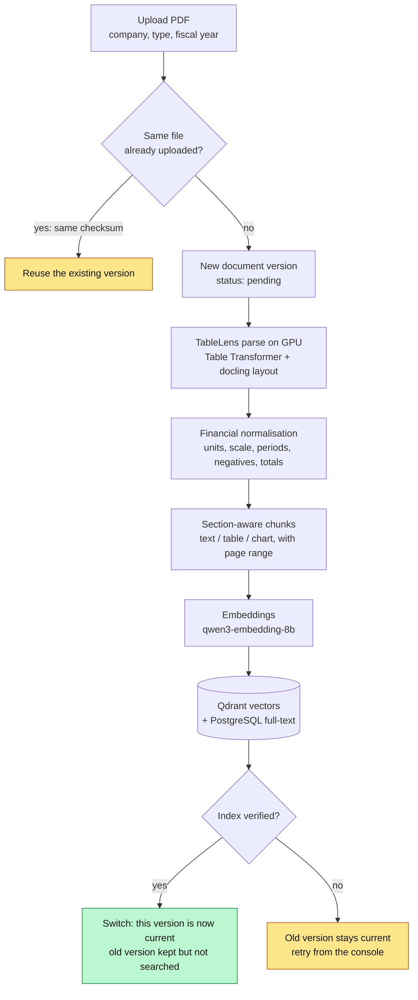
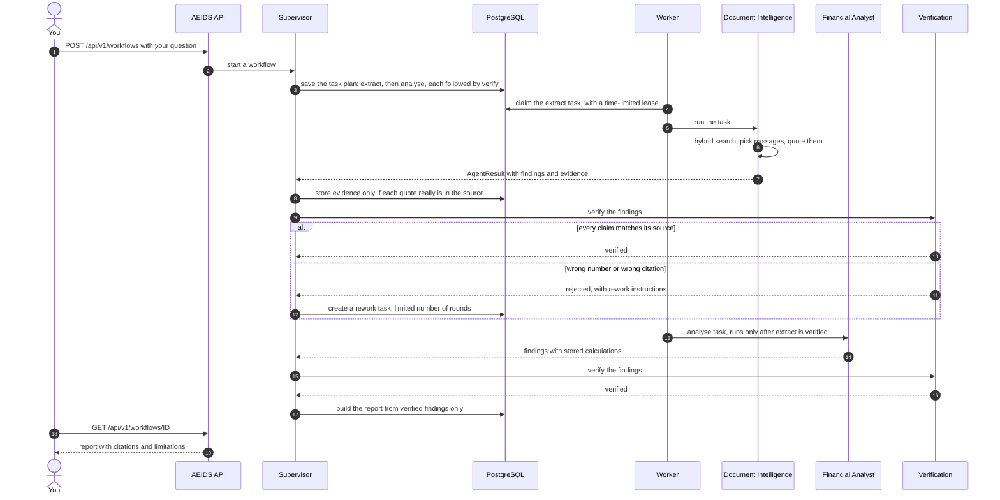
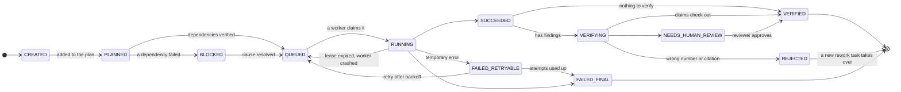
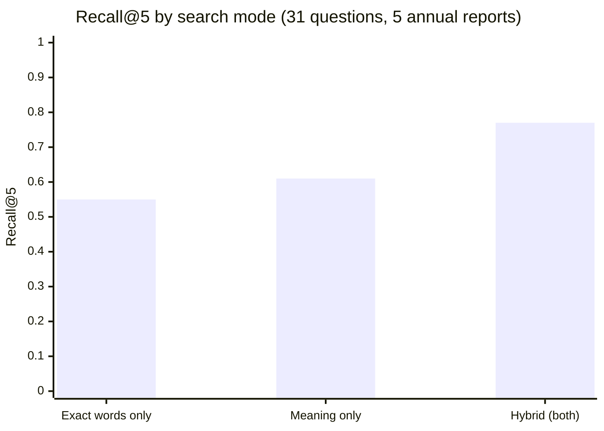

# AEIDS — Autonomous Enterprise Intelligence & Decision System

> **Ask a hard question about a company's annual report. Get an answer in which every claim points to the exact page it came from, every number is computed by tested code (not by the AI), and every claim has been checked by a separate reviewer before you see it.**

AEIDS reads company documents (annual reports, ESG / BRSR reports) and answers questions about them with a small team of AI agents: a **Supervisor** plans the work, specialist agents do it, and a **Verification** agent checks every claim against the source before it can reach the report. AEIDS is **decision support**, not a final legal, financial or compliance determination.

**Contents:** [Understanding the project](#understanding-the-project) · [How it works, in five pictures](#how-it-works-in-five-pictures) · [What an answer looks like](#what-an-answer-looks-like) · [Status](#status) · [Run locally](#run-locally) · [Console](#console-and-run-tracing) · [Workflows](#workflows-ask-a-question) · [Search](#search) · [Tests](#tests)

- Design: [docs/ARCHITECTURE.md](docs/ARCHITECTURE.md)
- What is being built now (Release 0): [docs/MVP_PLAN.md](docs/MVP_PLAN.md)
- Decisions: [docs/DECISIONS.md](docs/DECISIONS.md)
- PDF parsing: TableLens, in [`tablelens/`](tablelens/README.md) (copied from `../IntelligencePDF`, D-020)

---

## Understanding the project

### The problem

A company's annual report is 100–300 pages of text, tables and charts. To answer a question like *"How dependent is NVIDIA on its largest customers?"* an analyst has to find the right tables, check the units (thousands? millions? crore?), make sure the year is right, copy the figures out and do the maths. That takes hours, and it is easy to get one detail wrong.

A general chatbot is faster, but you cannot trust it with this work. It can make up a number, quote last year's report, mix up two companies or get the arithmetic wrong, and you cannot tell which sentence is the wrong one.

### What AEIDS does about it

AEIDS works like a small analyst team with a strict reviewer. Each role is a separate, narrowly scoped component:

| In a real analyst team | In AEIDS | What it does |
|---|---|---|
| Team lead | **Supervisor** | Splits the question into small typed tasks, decides their order, handles retries and rework. The only component that may change task state. |
| Researcher | **Document Intelligence agent** | Searches the reports and returns exact quotes with page, section and position on the page. |
| Financial analyst | **Financial Analyst agent** | Turns the extracted figures into ratios, growth rates and comparisons. The arithmetic is done by a deterministic calculation module (`aeids/calc/`, arriving in M4), not by the language model. |
| Auditor | **Verification agent** | Checks every claim against its source quote. A wrong number or a wrong citation is rejected and sent back for a limited number of rework rounds. |
| Report writer | **Reporting** | Builds the report from verified findings only, and lists what could not be verified as limitations. |

### Who it is useful for

- **Equity and credit analysts** comparing companies across annual reports.
- **ESG and compliance teams** mapping what a company has disclosed.
- **Auditors and consultants**, who have to show where every number came from.
- **Engineers building AI systems**: AEIDS is a worked example of a multi-agent system you can trust and inspect, with typed contracts, state machines saved to the database, crash-safe workers, tracing and a benchmark.

### How it differs from "chat with your PDF"

| | Typical chatbot over a PDF | AEIDS |
|---|---|---|
| Sources | Sometimes a page number, often none | Every finding links to evidence: document version, page, section, quote, and the box on the page where available |
| Numbers | The language model does the arithmetic and can get it wrong | Deterministic, tested functions; formula, inputs (value, unit, scale, currency, period) and version are stored, so any number can be recomputed |
| Wrong answers | Reach the user | Rejected by the Verification agent and reworked a limited number of times; whatever is still unverified is listed as a limitation |
| Old reports | Old and new versions get mixed | Explicit document versions; search uses only the current one by default |
| A crash halfway through | Start again | Every state change is saved in PostgreSQL; the workflow resumes without redoing finished tasks |
| Quality | Hard to measure | Retrieval benchmark today; full comparison against a single-agent baseline is planned |

### The rules it never breaks

1. **No evidence, no finding.** A claim without a source quote is not allowed into the report.
2. **No arithmetic by the language model.** All numbers come from the calculation module.
3. **Typed messages only.** Agents exchange validated `TaskMessage` / `AgentResult` objects; they never talk to each other directly.
4. **Document text is data, never instructions.** Text in an uploaded report cannot steer an agent or call a tool.
5. **Every step is recorded.** Each state change, model call and search is saved and visible in the console.

---

## How it works, in five pictures

> GitHub draws these diagrams live: hover over a diagram and use the controls to **zoom, pan or open it full screen**. Click any **▶ row** to expand the details.

### 1. The big picture

A question comes in, the Supervisor turns it into tasks, the agents work on evidence from your documents, and only verified findings reach the report.



### 2. From PDF to searchable evidence

When you upload a report, a background job turns it into small, labelled pieces of text and tables that can be searched by meaning and by exact words. A new version only replaces the old one once it is fully indexed, so search never sees a half-processed report.



<details>
<summary><b>▶ How search ranks results (hybrid search)</b></summary>

Every question is searched two ways at once:

- **By meaning** (dense vectors in Qdrant): finds *"revenue from top customers"* even when the report says *"concentration of sales"*.
- **By exact words** (PostgreSQL full-text search): finds exact terms such as *"BRSR"*, *"FY2025"* or a product name.

The two ranked lists are merged with **Reciprocal Rank Fusion (RRF)**: a passage that ranks high in either list rises to the top. Each result is then re-checked in PostgreSQL so it belongs to your tenant and to a *current* document version.

</details>

### 3. The life of one question

What happens between sending a question and getting a report. Every arrow that changes a task's state is written to PostgreSQL, so a worker crash at any point is safe: the next worker picks up where the last one stopped.



### 4. Every task follows a strict lifecycle

A task can only move along these arrows. Any other move raises an error and nothing is written, which is what makes the system predictable and resumable.



<details>
<summary><b>▶ Why a rejected task is never re-run, and how rework works</b></summary>

A `REJECTED` task stays rejected, so the record of what went wrong is kept. The Supervisor creates a **new rework task** linked to it (`parent_task_id`, `rework_round + 1`) that carries the verifier's instructions, for example *"the quoted figure is from FY2024, not FY2025"*. Tasks that depended on the rejected one now wait for the rework task instead. When no rework rounds are left, the dependents become `BLOCKED`, and the report lists the gap as a limitation instead of guessing.

The full transition tables for tasks and workflows are in [docs/ARCHITECTURE.md §3.1](docs/ARCHITECTURE.md), and the code that enforces them is [aeids/orchestration/states.py](aeids/orchestration/states.py).

</details>

### 5. Does search find the right page?

Every answer depends on search finding the right page first, so it is measured. The retrieval benchmark asks 31 questions with known answer pages over the annual reports of five companies (Apple, Microsoft, NVIDIA, Tesla, Alphabet). *Recall@5* is the share of questions whose correct page is among the top 5 results.



| Search mode | Recall@5 | Recall@10 | MRR@10 |
|---|---|---|---|
| Exact words only (`keyword`) | 0.55 | 0.81 | 0.37 |
| Meaning only (`dense`) | 0.61 | 0.81 | 0.53 |
| **Hybrid (default)** | **0.77** | **0.90** | **0.53** |

Combining both kinds of search finds the right page in the top 5 for about 3 questions in 4, and in the top 10 for 9 in 10. Runs are repeatable (D-023). See [Retrieval benchmark](#retrieval-benchmark) to run it yourself.

---

## What an answer looks like

Each finding in a report is a typed object, not free text. The example below is **illustrative** (a made-up company, the format the agents will produce from M4 on): it shows how a single number stays traceable to its calculation, its inputs, and the quoted lines of the report.

<details>
<summary><b>▶ Example finding (JSON)</b></summary>

```json
{
  "claim": "Acme Ltd's revenue grew 12.5% from FY2024 to FY2025.",
  "value": "12.5",
  "unit": "percent",
  "period": "FY2025",
  "calculation": {
    "function": "growth_rate",
    "formula": "(current - previous) / previous * 100",
    "inputs": {
      "current":  {"value": "4500", "unit": "currency", "currency": "INR", "scale": "crore", "period": "FY2025"},
      "previous": {"value": "4000", "unit": "currency", "currency": "INR", "scale": "crore", "period": "FY2024"}
    },
    "output": "12.5",
    "calc_version": "1.0"
  },
  "evidence": [
    {"relation": "supports", "page": 87, "section": "Statement of Profit and Loss",
     "quote": "Revenue from operations 4,500 ... 4,000"}
  ],
  "verification_status": "verified"
}
```

Note the details: money is a decimal string (never a float), and unit, currency and scale are separate fields, so "4,500 crore INR" cannot be misread as "4,500 million USD".

</details>

<details>
<summary><b>▶ Glossary</b></summary>

| Term | Meaning |
|---|---|
| **Agent** | A component with one narrow job (find evidence, analyse, verify) that receives a typed task and returns a typed result. |
| **Supervisor** | The planner and the only component allowed to change task or workflow state. |
| **Workflow** | One question and everything done to answer it: its task graph, results and report. |
| **Evidence record** | A stored quote from a specific document version, page and section, with its box on the page where available. |
| **Finding** | A claim plus its evidence (and calculation, for numbers). No evidence, no finding. |
| **Document version** | Each upload of a report. Only the *current* version is searched by default; old ones are kept. |
| **Chunk** | A searchable piece of a report: a section of text, a table or a chart, with its page range. |
| **Hybrid search / RRF** | Searching by meaning and by exact words, then merging the two rankings with Reciprocal Rank Fusion. |
| **Lease** | A time limit on a worker's claim on a task; if the worker dies, the task is queued again after the lease expires. |
| **Idempotency key** | A unique key per task so that a restarted workflow never runs finished work twice. |
| **TableLens** | The PDF parser (in `tablelens/`) that finds tables, charts and reading order, and keeps page and position for every value. |

</details>

<details>
<summary><b>▶ Where things are in the code</b></summary>

| Folder | What is in it |
|---|---|
| [`aeids/api/`](aeids/api/) | FastAPI app: documents, search, workflows, and the web console |
| [`aeids/documents.py`](aeids/documents.py) | Upload checks, checksum dedupe, document versions |
| [`aeids/ingestion/`](aeids/ingestion/) | Reads TableLens output; normalisation, chunking, embeddings, indexing |
| [`aeids/retrieval/`](aeids/retrieval/) | Hybrid search with tenant and current-version filters |
| [`aeids/contracts/`](aeids/contracts/) | Typed messages: `TaskMessage`, `AgentResult`, `Finding`, evidence |
| [`aeids/orchestration/`](aeids/orchestration/) | Supervisor, state machines, workers with leases |
| [`aeids/agents/`](aeids/agents/) | The agents (stand-ins until M4) |
| [`aeids/llm/`](aeids/llm/) | The single entry point for model calls (OpenRouter), with retries and cost tracking |
| [`tablelens/`](tablelens/) | PDF parsing pipeline, run as its own service |
| [`eval/`](eval/) | Benchmark questions, corpus list and runners |
| [`docs/`](docs/) | Architecture, MVP plan, decision log |

</details>

---

## Status

What works today: uploading reports, versioning, automatic parsing, hybrid search, the Supervisor with its task plan, crash-safe workers, verification of citations, tracing and the web console. The agents inside a workflow are still **stand-ins**: they run real searches and real citation checks, but do not yet extract figures or write analysis. That is the next milestone (M4).

| Milestone | State |
|---|---|
| M1 Foundation: upload, versioning, checksum dedupe, data-foundation tables | done |
| M2 Ingestion and retrieval | done: TableLens parse → normalised tables → chunks → embeddings + Qdrant → hybrid search; retrieval benchmark |
| Tracing + console | done: LangSmith-style traces in Postgres, web console at `/ui` (D-022) |
| M3 Contracts and Supervisor | done: typed agent messages, task/workflow state machines, Supervisor with retries and rework, crash-safe workers, workflow API and console page (D-024) |
| M4–M7 | not started: LLM Document Intelligence and Financial Analyst, calculation module, report output, single-agent baseline and full benchmark |

## Run locally

Needs Python 3.11, [uv](https://docs.astral.sh/uv/) and Docker (colima on macOS).

```bash
uv venv --python 3.11 .venv && uv pip install --python .venv/bin/python -r requirements.txt
cp .env.example .env              # set AEIDS_DB_PASSWORD, and the same password in AEIDS_DATABASE_URL
./start.sh                        # everything: services, database, TableLens, API, worker
```

`./start.sh` starts Postgres, Qdrant and Redis with `docker compose up -d` if they are not running, migrates the database, then runs TableLens (port 8000), the AEIDS API (port 8001) and the background worker in one window, each line labelled with its name. Ctrl+C stops all three; the Docker services keep running. `./start.sh --no-tablelens` skips parsing (search and questions on reports already parsed); `./start.sh --help` lists the options. If another project's containers hold ports 5432 / 6379 / 6333, it names them and asks whether to stop them (their data is kept; `docker start <name>` brings them back), then starts this project's own services.

API docs: http://127.0.0.1:8001/docs

### Models (OpenRouter)

Embeddings use `qwen/qwen3-embedding-8b` and the LLM is `qwen/qwen3.8-flash`, both through [OpenRouter](https://openrouter.ai). Put your key in `.env` as `AEIDS_OPENROUTER_API_KEY=...`, then check the setup (sends two fixed test sentences, no document content):

```bash
.venv/bin/python -m aeids.llm check
```

Chunk text from uploaded reports is sent to OpenRouter for embedding.

```bash
# upload a report (creates the document and version 1)
curl -F file=@report.pdf -F company_name="Acme Ltd" -F document_type=annual_report -F fiscal_year=2025 \
     http://127.0.0.1:8001/api/v1/documents
# upload a replacement version, then list versions and their processing status
curl -F file=@report-v2.pdf http://127.0.0.1:8001/api/v1/documents/<document_id>/versions
curl http://127.0.0.1:8001/api/v1/documents/<document_id>/versions
```

### Automatic parsing with TableLens

Uploaded PDFs are parsed by TableLens (`tablelens/`) automatically: the upload queues a background job, which sends the PDF to the TableLens server and chunks the result. TableLens has its own Python env (torch, paddle), kept apart from AEIDS':

```bash
cd tablelens && uv venv --python 3.11 .venv && uv pip install --python .venv/bin/python -r requirements.txt
```

`./start.sh` runs it (it finds `tablelens/.venv`, else the old `../IntelligencePDF/.venv-tablelens`; or set `AEIDS_TABLELENS_PYTHON`). To run the pieces by hand instead:

```bash
(cd tablelens && .venv/bin/python app.py)           # TableLens on :8000 (uses its Modal GPU server when deployed)
.venv/bin/uvicorn aeids.api.app:create_app --factory --port 8001
.venv/bin/python -m aeids.worker                    # background jobs (needs Redis)

.venv/bin/python -m aeids.worker status             # TableLens, queue, versions by status
.venv/bin/python -m aeids.worker requeue            # re-queue versions left pending / failed
```

Watch a version go `pending → parsing → parsed → indexing → indexed` in `GET /api/v1/documents/<id>/versions`. Re-run one with `POST /api/v1/documents/<id>/versions/<vid>/process` (add `?reuse_by_filename=true` to reuse a TableLens result made earlier for the same file name).

### Attach TableLens output by hand

You can still attach an existing `_structure.json` yourself:

```bash
curl -F file=@../IntelligencePDF/output/<name>/structure/<name>_structure.json \
     http://127.0.0.1:8001/api/v1/documents/<document_id>/versions/<version_id>/structure
curl "http://127.0.0.1:8001/api/v1/documents/<document_id>/versions/<version_id>/chunks?limit=20"

# without the API or a database: what AEIDS reads from a structure file
.venv/bin/python -m aeids.ingestion inspect ../IntelligencePDF/output/<name>/structure/<name>_structure.json
```

## Console and run tracing

Open **http://127.0.0.1:8001/ui** (after `./start.sh`). Pages:

| Page | What you see |
|---|---|
| Overview | service health, totals, the ingestion pipeline, activity, latency by step, version states |
| Documents | **upload** a PDF (drag and drop; company, type, fiscal year), upload a new version of a report, retry a failed one; every version's progress: uploaded → parsing → parsed → indexing → indexed & current (the page follows processing by itself) |
| Search | ask a question; each hit shows company, page, section, and its rank by meaning and by exact words; link to its trace |
| Evaluation | benchmark scores by mode, a rank heatmap for every question, run history |
| Traces | every run (processing job, search, benchmark) as a timeline of steps, like LangSmith: timing, tokens, cost, inputs, outputs, errors |
| Logs | TableLens, API, worker and launcher output (from `logs/`, written by `./start.sh`); filters and Live follow |

Use the tenant selector (top right) to switch between your uploads (`default`) and the benchmark corpus (`eval`). Traces are stored in Postgres (`trace_spans`); turn storing off with `AEIDS_TRACING_ENABLED=false`. The console has no login: keep the API on 127.0.0.1.

## Workflows (ask a question)

In the console open **Workflows**, or call the API:

```bash
curl -s http://127.0.0.1:8001/api/v1/workflows -H 'content-type: application/json' \
     -d '{"query": "How dependent is NVIDIA on its largest customers?"}'
```

The Supervisor plans a task graph (`extract` → `analyse`, plus a `verify` task for every task with findings), the worker runs it, and every state change is saved. `GET /api/v1/workflows/{id}/tasks` shows the graph with attempts and transitions, `/findings` the claims with their evidence quotes, `/{id}` the report (verified findings only). Until M4 the agents are stand-ins: real search and real verification of the citations, but no figures extracted yet.

## Search

A version becomes searchable, and current, once its chunks are embedded and indexed in Qdrant. Until then the previous version stays current. Search the current versions of your documents:

```bash
curl -s http://127.0.0.1:8001/api/v1/search -H 'content-type: application/json' \
     -d '{"query": "What were total net sales in 2025?", "top_k": 5}'
```

Each hit has its company, file, version, pages, section, kind (text / table / chart) and text, plus its rank in each list. `mode` is `hybrid` (default: meaning + exact words, fused with RRF), `dense` (meaning, Qdrant) or `keyword` (exact words, Postgres full-text search). Optional filters: `company_ids`, `document_ids`, `fiscal_years`; `include_superseded: true` also searches replaced versions.

### Retrieval benchmark

```bash
.venv/bin/python eval/run_retrieval.py              # loads + indexes the 5 reports (once), then scores
.venv/bin/python eval/run_retrieval.py check-gold   # re-derive the gold pages from the TableLens output
```

It loads the reports in [eval/corpus.csv](eval/corpus.csv) into a separate `eval` tenant from their existing TableLens output (no GPU), indexes them (about USD 0.006 of embeddings), and asks the 31 questions in [eval/retrieval_questions.jsonl](eval/retrieval_questions.jsonl). It prints Recall@5, Recall@10 and MRR@10 per mode and writes details to `reports/`. Results are repeatable (D-023): embeddings come from one pinned OpenRouter provider (`AEIDS_EMBEDDING_PROVIDER`, default `nebius`) and question vectors are cached, so a re-run gives identical ranks. Current: hybrid R@5 0.77, R@10 0.90, MRR 0.53. After changing provider or model, run with `--reindex`.

## Tests

```bash
.venv/bin/pytest                                    # SQLite
AEIDS_TEST_DATABASE_URL=postgresql+psycopg://aeids:<pw>@127.0.0.1:5432/aeids_test .venv/bin/pytest
```

The Postgres test database is wiped at the start and end of a run; never point it at a database you need.
