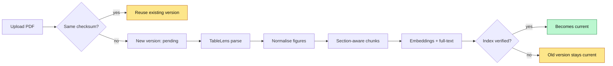
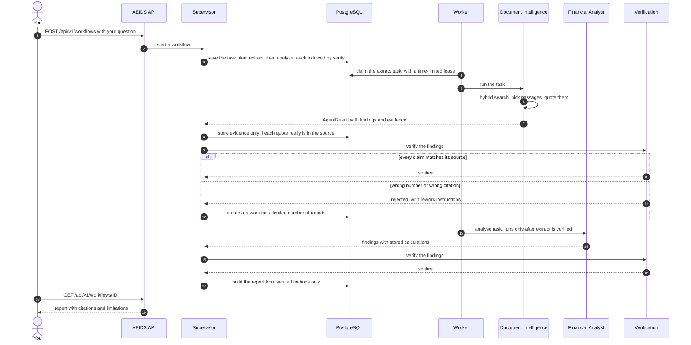
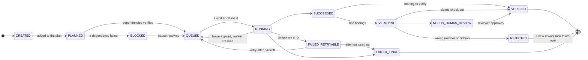

<p align="center">
  
</p>

<p align="center">
  
  
  
  
  
  
</p>

<p align="center">
  <a href="#understanding-the-project"></a>
  <a href="#how-it-works"></a>
  <a href="#the-agent-team"></a>
  <a href="#why-you-can-trust-the-numbers"></a>
  <a href="#quick-start"></a>
</p>

# AEIDS — Autonomous Enterprise Intelligence & Decision System

Ask a hard question about a company's annual report, for example *"How dependent is NVIDIA on its largest customers?"* or *"How did Tesla's gross margin change?"*. AEIDS answers it with a small team of AI agents: a **Supervisor** plans the work, specialist agents find the evidence and do the analysis, and a **Verification** agent checks every claim against the source before it can reach the report.

What you get back is not a paragraph you have to take on trust. Each claim links to the exact **page, section and quote** it came from, and every number is computed by **tested code, not by the language model**, so anyone can recompute it.

> [!NOTE]
> AEIDS is **decision support**. It does not make final legal, financial or compliance determinations.

---

## Understanding the project

### The problem

A company's annual report runs to 100–300 pages of text, tables and charts. To answer one question an analyst has to find the right table, check the units (thousands? millions? crore?), make sure the year is right, copy the figures out and do the maths. That takes hours, and one wrong detail spoils the answer.

A general chatbot is faster, but you can't trust it with this work. It can make up a number, quote last year's report, mix up two companies or get the arithmetic wrong, and you can't tell which sentence is the wrong one.

### What AEIDS does about it

AEIDS works like **a small analyst team with a strict auditor**. Every role is a separate, narrowly scoped component, and nothing reaches you until the auditor has checked it against the source.

| | Typical "chat with your PDF" | AEIDS |
|---|---|---|
| **Sources** | Sometimes a page number, often none | Every finding links to evidence: document version, page, section, quote, and its box on the page where available |
| **Numbers** | The language model does the arithmetic | Deterministic, tested functions; formula and typed inputs are stored, so any number can be recomputed |
| **Wrong answers** | Reach you | Rejected by the Verification agent and reworked a limited number of times; what is still unverified is listed as a limitation |
| **Old reports** | Old and new versions get mixed | Explicit document versions; search uses only the current one by default |
| **A crash halfway** | Start again | Every state change is saved; the workflow resumes without redoing finished tasks |
| **Quality** | Hard to measure | A repeatable benchmark ([see results](#does-search-find-the-right-page)) |

### Who it is for

| If you are... | AEIDS helps you... |
|---|---|
| **An equity or credit analyst** | compare companies across annual reports without copying tables by hand |
| **On an ESG or compliance team** | map what a company has disclosed, with the page for each point |
| **An auditor or consultant** | show where every number came from, and how it was computed |
| **An engineer building AI systems** | study a working multi-agent system with typed contracts, persisted state machines, crash-safe workers, tracing and evaluation |

---

## How it works

<p align="center">
  <a href="#the-seven-steps-in-detail"></a>
</p>

Reports are prepared **once**, when they are uploaded: parsed by TableLens (text, tables and charts, each with its page and position), cut into searchable pieces and indexed. Every **question** then runs through the agent team. Click the graphic, or open the sections below, for the details.

### The seven steps in detail

<details>
<summary><b>① – ③ &nbsp;Upload, parse, index</b>: how a PDF becomes searchable evidence</summary>
<br>

| Step | What happens | Where in the code |
|---|---|---|
| **Upload** | The PDF is stored and gets a document version. The same file uploaded twice (same checksum) is not processed again. | [`aeids/documents.py`](aeids/documents.py) |
| **Parse** | A background job sends the PDF to **TableLens**, which finds tables (Table Transformer + docling layout), charts and reading order, keeping page and box for every value. | [`tablelens/`](tablelens/README.md), [`aeids/jobs.py`](aeids/jobs.py) |
| **Normalise** | Numbers are cleaned up: units, scale (thousand, million, crore), periods, negatives in brackets, totals. | [`aeids/ingestion/`](aeids/ingestion/) |
| **Chunk** | The report is cut into section-aware pieces of text, tables and charts, each with its page range. | [`aeids/ingestion/`](aeids/ingestion/) |
| **Index** | Pieces are embedded (`qwen3-embedding-8b`) into Qdrant and indexed for full-text search in PostgreSQL. | [`aeids/ingestion/`](aeids/ingestion/) |
| **Switch** | Only after the index is verified does the new version become *current*. The old one is kept but no longer searched. | [`aeids/ingestion/`](aeids/ingestion/) |



You can watch each version go `pending → parsing → parsed → indexing → indexed` on the console's Documents page.

</details>

<details>
<summary><b>Search</b>: why AEIDS searches two ways at once</summary>
<br>

- **By meaning** (dense vectors in Qdrant) finds *"revenue from top customers"* even when the report says *"concentration of sales"*.
- **By exact words** (PostgreSQL full-text search) finds exact terms such as *"BRSR"*, *"FY2025"* or a product name.

The two rankings are merged with **Reciprocal Rank Fusion (RRF)**: a passage that ranks high in either list rises to the top. Every result is then re-checked in PostgreSQL so it belongs to your tenant and to a *current* document version. Code: [`aeids/retrieval/`](aeids/retrieval/).

</details>

<details>
<summary><b>④ – ⑦ &nbsp;Plan, investigate, verify, report</b>: the life of one question, step by step</summary>
<br>

Every arrow that changes a task's state is written to PostgreSQL, so a worker crash at any point is safe: the next worker picks up where the last one stopped. The diagram is zoomable: hover over it and use the controls.



</details>

---

## The agent team

<p align="center">
  <a href="#agents-in-detail"></a>
</p>

Agents never talk to each other. They receive a typed `TaskMessage`, return a typed `AgentResult` and *propose* what should happen next; only the Supervisor decides. That keeps every step checkable, replayable and safe to retry.

### Agents in detail

<details>
<summary><b>Supervisor</b>: the team lead</summary>
<br>

Turns your question into the smallest set of verifiable tasks (`extract` → `analyse`, plus a `verify` task for every task with findings), declares their dependencies, and is **the only component allowed to change task or workflow state**. It retries temporary failures with backoff, never retries permission errors, and creates rework tasks for rejected findings. Its `tick` is idempotent, so running it twice never doubles any work. Code: [`aeids/orchestration/supervisor.py`](aeids/orchestration/supervisor.py).

</details>

<details>
<summary><b>Document Intelligence</b>: the researcher</summary>
<br>

Runs hybrid search over the current versions of your reports and returns exact quotes with page, section and box. The Supervisor stores a quote as an evidence record **only after checking that the quote really appears in the source text**, so an agent cannot invent a citation.

</details>

<details>
<summary><b>Financial Analyst</b>: the analyst</summary>
<br>

Turns extracted figures into ratios, growth rates and comparisons. It **never does arithmetic itself**: every number comes from the deterministic calculation module, and the function, formula, typed inputs (value, unit, scale, currency, period), output and version are stored with the finding. Money is always `Decimal`, never a float.

</details>

<details>
<summary><b>Verification</b>: the auditor</summary>
<br>

Checks every finding against its evidence: is the quote in the source, does the value equal its calculation, do units, scale and period agree, is it the current version of the report? A failure is **rejected**, never silently fixed. The Supervisor then creates a rework task carrying the verifier's instructions, for a limited number of rounds.

</details>

<details>
<summary><b>Task lifecycle</b>: the only moves a task can make</summary>
<br>

Any move not shown here raises an error and nothing is written. Rules and code: [docs/ARCHITECTURE.md §3.1](docs/ARCHITECTURE.md), [`aeids/orchestration/states.py`](aeids/orchestration/states.py).



A rejected task is never re-run, so the record of what went wrong is kept. Its rework task (`parent_task_id`, `rework_round + 1`) takes over its dependents. When no rework rounds are left, the dependents become `BLOCKED` and the report lists the gap as a limitation.

</details>

---

## Why you can trust the numbers

<p align="center">
  
</p>

Every finding is a typed object, not free text. The graphic above is an **illustrative example** (a made-up company) of the format the agents produce (see a real run in [Status](#status)). Four rules make it trustworthy:

| Rule | What it means in practice |
|---|---|
| **No evidence, no finding** | A claim without a stored source quote cannot exist; the contract rejects it. |
| **No LLM arithmetic** | Numbers come from tested functions, with formula and inputs stored for recomputation. |
| **Document text is data, never instructions** | Text in an uploaded report cannot steer an agent or call a tool. |
| **Every step is recorded** | Each state change, model call and search is a trace you can open in the console. |

<details>
<summary><b>See the finding above as JSON</b></summary>
<br>

```json
{
  "claim": "Acme Ltd's revenue grew 12.5% from FY2024 to FY2025.",
  "value": "12.5",
  "unit": "percent",
  "period": "FY2025",
  "calculation": {
    "function": "growth_rate",
    "formula": "(current - previous) / previous * 100",
    "inputs": {
      "current":  {"value": "4500", "unit": "currency", "currency": "INR", "scale": "crore", "period": "FY2025"},
      "previous": {"value": "4000", "unit": "currency", "currency": "INR", "scale": "crore", "period": "FY2024"}
    },
    "output": "12.5",
    "calc_version": "1.0"
  },
  "evidence": [
    {"relation": "supports", "page": 87, "section": "Statement of Profit and Loss",
     "quote": "Revenue from operations 4,500 ... 4,000"}
  ],
  "verification_status": "verified"
}
```

Money is a decimal string, never a float, and unit, currency and scale are separate fields, so "4,500 crore INR" cannot be misread as "4,500 million USD".

</details>

### Does search find the right page?

<p align="center">
  
</p>

Every answer depends on finding the right page first, so it is measured. Combining both kinds of search finds the right page in the top 5 for about 3 questions in 4, and in the top 10 for 9 in 10. The run is repeatable (D-023); [run it yourself](#retrieval-benchmark).

<details>
<summary><b>Exact scores</b></summary>
<br>

| Search mode | Recall@5 | Recall@10 | MRR@10 |
|---|---|---|---|
| Exact words only (`keyword`) | 0.55 | 0.81 | 0.37 |
| Meaning only (`dense`) | 0.61 | 0.81 | 0.53 |
| **Hybrid (default)** | **0.77** | **0.90** | **0.53** |

</details>

### Does AEIDS beat one RAG prompt?

The same 36 questions go to AEIDS and to a single-agent baseline: the same search, the same model, one prompt that answers with citations. Both are scored the same way: the right numbers stated, cited pages that hold them, and no number the cited pages do not print (D-029).

| | AEIDS | Baseline (one RAG prompt) |
|---|---:|---:|
| **Answers correct** | **92%** | 69% |
| &nbsp;&nbsp;lookups (14) | 79% | 79% |
| &nbsp;&nbsp;calculations (10) | 100% | 80% |
| &nbsp;&nbsp;comparisons across companies (6) | 100% | 0% |
| &nbsp;&nbsp;not in the reports, says so (6) | 100% | 100% |
| Answers with a correct citation | 93% | 63% |
| **Numbers not printed on a cited page** | **0%** of 65 | 12% of 48 |
| Time per question, median / p95 | 4.6 s / 10.5 s | 2.0 s / 2.5 s |
| Tokens / cost per question | 4,553 / USD 0.0004 | 3,395 / USD 0.0002 |

Over three runs in the [Release 0 review](docs/RELEASE_0_REVIEW.md), AEIDS scored 89–92%. One lookup, Apple's diluted earnings per share, depends on how the planning model reads the question. The other numbers held in every run: 0% unchecked numbers, 100% on calculations and comparisons, and no errors.

AEIDS is about 2 s slower and calculates and compares reliably, and every number it states is checked. Code reads values the tables already hold and the model is asked only when a match is unclear, which cut time per question from 22 s to under 5 s and tokens by half (D-030). Its three misses are headcounts printed only in prose. [Run it yourself](#end-to-end-benchmark).

---

## Status

> [!IMPORTANT]
> **What works today:** uploading reports, versioning, automatic parsing, hybrid search, the Supervisor and its task plan, crash-safe workers, citation verification, tracing and the web console.
> **New in M4:** Document Intelligence reads reported values from the parsed tables, and the Financial Analyst calculates margins and growth with the calculation module. For example, *"Compare Apple's revenue and operating margin FY2023–FY2025"* on Apple's 10-K gives 6 reported values (page 32) and 5 calculations (operating margin 29.82% → 31.51% → 31.97%), all verified, for about USD 0.002.
> **Metric knowledge base:** [`aeids/knowledge/metrics.yaml`](aeids/knowledge/metrics.yaml) defines 41 metrics (margins, growth, ROE, free cash flow, leverage, BRSR intensities, women's representation, LTIFR, CSR spend) as fixed recipes of tested calculation steps, plus how US GAAP, Ind AS and BRSR reports name each line item. The agents pick a metric and the facts; code runs the recipe.
> **New in M5:** Verification replays every calculation and checks every value against the table cell it came from (value, page, unit, currency, scale, period, current version). Wrong findings go back for at most two rework rounds; what still fails is dropped and listed as a limitation; what cannot be checked automatically waits for a person in the console.
> **New in M6:** a single-agent RAG baseline and one command that benchmarks both on 36 questions: AEIDS answers 89–92% correctly (three runs) vs 69%, with no unchecked numbers (baseline: 12%), at a median 4.6 s and USD 0.0004 per question ([results](#does-aeids-beat-one-rag-prompt)).
> **New in M7:** every completed question gets a stored, checked report (JSON and Markdown): the answer, every calculation with its inputs, numbered sources down to the page and evidence record, limitations, review status and how it was made. Before it is stored, code checks that it contains every verified finding and nothing else. A report that fails the check is not stored, and the workflow fails instead. Download it from the answer page, `GET /api/v1/workflows/{id}/report.md`, or `python -m aeids.reporting <id>`.
> **Not yet:** values printed only in prose or charts are not extracted.

| Milestone | State |
|---|---|
| M1 Foundation: upload, versioning, checksum dedupe, data-foundation tables | ✅ done |
| M2 Ingestion and retrieval: TableLens parse → normalised tables → chunks → embeddings + Qdrant → hybrid search; retrieval benchmark | ✅ done |
| Tracing + console: LangSmith-style traces in Postgres, web console at `/ui` (D-022) | ✅ done |
| M3 Contracts and Supervisor: typed agent messages, task/workflow state machines, Supervisor with retries and rework, crash-safe workers, workflow API and console page (D-024) | ✅ done |
| M4 LLM Document Intelligence and Financial Analyst, calculation module (D-025) | ✅ done |
| M5 Verification replays calculations and checks quoted values; bounded rework; human review; fault-injection tests (D-027) | ✅ done |
| M6 Single-agent RAG baseline and benchmark (AEIDS vs baseline, D-029); fewer and smaller model calls (D-030) | ✅ done |
| M7 Checked, versioned reports (JSON + Markdown) with citations, limitations and review status; report API, console download, CLI (D-031) | ✅ done |

## Quick start

```bash
git clone https://github.com/Numaa-droid/Autonomous-Enterprise-Intelligence-Decision-System.git
cd Autonomous-Enterprise-Intelligence-Decision-System
uv venv --python 3.11 .venv && uv pip install --python .venv/bin/python -r requirements.txt
cp .env.example .env        # set AEIDS_DB_PASSWORD (and the same in AEIDS_DATABASE_URL), AEIDS_OPENROUTER_API_KEY
./start.sh                  # Postgres, Qdrant, Redis, migrations, TableLens, API and worker
```

Then open **http://127.0.0.1:8001/ui**: upload a report on **Reports**, ask a question on **Ask a question**, and watch every step on **Run history**.

**A five-minute demo** (no GPU needed; it uses the five reports the benchmark loads):

1. `.venv/bin/python eval/run_retrieval.py` loads Apple, Microsoft, NVIDIA, Tesla and Alphabet into the `eval` workspace (once, about USD 0.006).
2. In the console, pick the **eval** workspace (top right), open **Ask a question** and ask *"Compare the net profit margins of Alphabet in 2025 and Apple in fiscal year 2025."*
3. The answer page shows the two margins, the four figures they come from (with file and page), and a plain-English summary. Open **How AEIDS got this answer** to see the task plan, each check and the timeline.
4. Click **Download the report (Markdown)**. The file has the answer, each calculation with its cited inputs, limitations, review status and numbered sources.
5. Ask something the reports cannot answer (*"What were Apple's total net sales in fiscal year 2030?"*): AEIDS says so instead of guessing.
6. `.venv/bin/python eval/run_benchmark.py` compares AEIDS with the single-prompt baseline on 36 questions (about USD 0.02).

> [!WARNING]
> The console has no login. Keep the API bound to `127.0.0.1`.

<details>
<summary><b>FAQ</b></summary>
<br>

**Is this just RAG?** Search (retrieval) is one step. On top of it, AEIDS plans typed tasks, keeps arithmetic out of the language model, verifies every claim against its source, and saves every state change so a workflow can resume and be audited.

**Which documents does it handle?** Annual reports and ESG / BRSR reports as PDFs, native or scanned (TableLens uses a GPU model for scans and charts).

**Which models does it use?** Embeddings `qwen/qwen3-embedding-8b` and LLM `qwen/qwen3.8-flash`, both through OpenRouter. All calls go through one module with retries, cost and latency tracking. Tests never call the network.

**Does my data leave my machine?** Original files and the database stay local. Chunk text is sent to OpenRouter to compute embeddings, and to the LLM when agents run.

**Can it give investment or legal advice?** No. It is decision support: it finds, computes and cites, and a person decides.

</details>

<details>
<summary><b>Glossary</b></summary>
<br>

| Term | Meaning |
|---|---|
| **Agent** | A component with one narrow job (find evidence, analyse, verify) that receives a typed task and returns a typed result. |
| **Supervisor** | The planner, and the only component allowed to change task or workflow state. |
| **Workflow** | One question and everything done to answer it: its task graph, results and report. |
| **Evidence record** | A stored quote from a specific document version, page and section, with its box on the page where available. |
| **Finding** | A claim plus its evidence (and its calculation, for numbers). No evidence, no finding. |
| **Document version** | Each upload of a report. Only the *current* version is searched by default; old ones are kept. |
| **Chunk** | A searchable piece of a report: a section of text, a table or a chart, with its page range. |
| **Hybrid search / RRF** | Searching by meaning and by exact words, then merging the two rankings with Reciprocal Rank Fusion. |
| **Lease** | A time limit on a worker's claim on a task; if the worker dies, the task is queued again when the lease expires. |
| **Idempotency key** | A unique key per task, so a restarted workflow never runs finished work twice. |
| **TableLens** | The PDF parser in `tablelens/` that finds tables, charts and reading order, and keeps the page and position of every value. |

</details>

<details>
<summary><b>Where things are in the code</b></summary>
<br>

| Folder | What is in it |
|---|---|
| [`aeids/api/`](aeids/api/) | FastAPI app: documents, search, workflows, and the web console |
| [`aeids/documents.py`](aeids/documents.py) | Upload checks, checksum dedupe, document versions |
| [`aeids/ingestion/`](aeids/ingestion/) | Reads TableLens output; normalisation, chunking, embeddings, indexing |
| [`aeids/retrieval/`](aeids/retrieval/) | Hybrid search with tenant and current-version filters |
| [`aeids/knowledge/`](aeids/knowledge/) | `metrics.yaml`: the metric knowledge base (financial and BRSR line items and metric recipes) and its checked loader |
| [`aeids/calc/`](aeids/calc/) | The deterministic calculation functions every number comes from |
| [`aeids/contracts/`](aeids/contracts/) | Typed messages: `TaskMessage`, `AgentResult`, `Finding`, evidence |
| [`aeids/orchestration/`](aeids/orchestration/) | Supervisor, state machines, workers with leases |
| [`aeids/agents/`](aeids/agents/) | The agents: Document Intelligence, Financial Analyst, Verification (and the M3 stand-ins) |
| [`aeids/llm/`](aeids/llm/) | The single entry point for model calls (OpenRouter), with retries and cost tracking |
| [`aeids/reporting/`](aeids/reporting/) | The answer arranged from verified findings, and the checked, stored report (JSON + Markdown) |
| [`aeids/baseline/`](aeids/baseline/), [`aeids/evaluation/`](aeids/evaluation/) | The single-prompt RAG baseline and the benchmark scoring used for both systems |
| [`tablelens/`](tablelens/README.md) | PDF parsing pipeline, run as its own service |
| [`eval/`](eval/) | Benchmark questions, corpus list and runners |
| [`docs/`](docs/) | [Architecture](docs/ARCHITECTURE.md), [MVP plan](docs/MVP_PLAN.md), [decision log](docs/DECISIONS.md) |
| [`assets/`](assets/) | README graphics, and `make_svgs.py`, which draws them (`python assets/make_svgs.py assets`) |

</details>

---

## Run locally

Needs Python 3.11, [uv](https://docs.astral.sh/uv/) and Docker (colima on macOS).

```bash
uv venv --python 3.11 .venv && uv pip install --python .venv/bin/python -r requirements.txt
cp .env.example .env              # set AEIDS_DB_PASSWORD, and the same password in AEIDS_DATABASE_URL
./start.sh                        # everything: services, database, TableLens, API, worker
```

`./start.sh` starts Postgres, Qdrant and Redis with `docker compose up -d` if they are not running, migrates the database, then runs TableLens (port 8000), the AEIDS API (port 8001) and the background worker in one window, each line labelled with its name. Ctrl+C stops all three; the Docker services keep running. `./start.sh --no-tablelens` skips parsing (search and questions on reports already parsed); `./start.sh --help` lists the options. If another project's containers hold ports 5432 / 6379 / 6333, it names them and asks whether to stop them (their data is kept; `docker start <name>` brings them back), then starts this project's own services.

API docs: http://127.0.0.1:8001/docs

### Models (OpenRouter)

Embeddings use `qwen/qwen3-embedding-8b` and the LLM is `qwen/qwen3.8-flash`, both through [OpenRouter](https://openrouter.ai). Put your key in `.env` as `AEIDS_OPENROUTER_API_KEY=...`, then check the setup (sends two fixed test sentences, no document content):

```bash
.venv/bin/python -m aeids.llm check
```

Chunk text from uploaded reports is sent to OpenRouter for embedding.

```bash
# upload a report (creates the document and version 1)
curl -F file=@report.pdf -F company_name="Acme Ltd" -F document_type=annual_report -F fiscal_year=2025 \
     http://127.0.0.1:8001/api/v1/documents
# upload a replacement version, then list versions and their processing status
curl -F file=@report-v2.pdf http://127.0.0.1:8001/api/v1/documents/<document_id>/versions
curl http://127.0.0.1:8001/api/v1/documents/<document_id>/versions
```

### Automatic parsing with TableLens

Uploaded PDFs are parsed by TableLens (`tablelens/`) automatically: the upload queues a background job, which sends the PDF to the TableLens server and chunks the result. TableLens has its own Python env (torch, paddle), kept apart from AEIDS':

```bash
cd tablelens && uv venv --python 3.11 .venv && uv pip install --python .venv/bin/python -r requirements.txt
```

`./start.sh` runs it (it finds `tablelens/.venv`, else the old `../IntelligencePDF/.venv-tablelens`; or set `AEIDS_TABLELENS_PYTHON`). To run the pieces by hand instead:

```bash
(cd tablelens && .venv/bin/python app.py)           # TableLens on :8000 (uses its Modal GPU server when deployed)
.venv/bin/uvicorn aeids.api.app:create_app --factory --port 8001
.venv/bin/python -m aeids.worker                    # background jobs (needs Redis)

.venv/bin/python -m aeids.worker status             # TableLens, queue, versions by status
.venv/bin/python -m aeids.worker requeue            # re-queue versions left pending / failed
```

Watch a version go `pending → parsing → parsed → indexing → indexed` in `GET /api/v1/documents/<id>/versions`. Re-run one with `POST /api/v1/documents/<id>/versions/<vid>/process` (add `?reuse_by_filename=true` to reuse a TableLens result made earlier for the same file name).

### Attach TableLens output by hand

You can still attach an existing `_structure.json` yourself:

```bash
curl -F file=@../IntelligencePDF/output/<name>/structure/<name>_structure.json \
     http://127.0.0.1:8001/api/v1/documents/<document_id>/versions/<version_id>/structure
curl "http://127.0.0.1:8001/api/v1/documents/<document_id>/versions/<version_id>/chunks?limit=20"

# without the API or a database: what AEIDS reads from a structure file
.venv/bin/python -m aeids.ingestion inspect ../IntelligencePDF/output/<name>/structure/<name>_structure.json
```

## Console and run tracing

Open **http://127.0.0.1:8001/ui** (after `./start.sh`). Pages:

| Page | What you see |
|---|---|
| Overview | service health, totals, the ingestion pipeline, activity, latency by step, version states |
| Documents | **upload** a PDF (drag and drop; company, type, fiscal year), upload a new version of a report, retry a failed one; every version's progress: uploaded → parsing → parsed → indexing → indexed & current (the page follows processing by itself) |
| Search | ask a question; each hit shows company, page, section, and its rank by meaning and by exact words; link to its trace |
| Evaluation | benchmark scores by mode, a rank heatmap for every question, run history |
| Traces | every run (processing job, search, benchmark) as a timeline of steps, like LangSmith: timing, tokens, cost, inputs, outputs, errors |
| Logs | TableLens, API, worker and launcher output (from `logs/`, written by `./start.sh`); filters and Live follow |

Use the tenant selector (top right) to switch between your uploads (`default`) and the benchmark corpus (`eval`). Traces are stored in Postgres (`trace_spans`); turn storing off with `AEIDS_TRACING_ENABLED=false`. The console has no login: keep the API on 127.0.0.1.

## Workflows (ask a question)

In the console open **Workflows**, or call the API:

```bash
curl -s http://127.0.0.1:8001/api/v1/workflows -H 'content-type: application/json' \
     -d '{"query": "How dependent is NVIDIA on its largest customers?"}'
```

The Supervisor plans a task graph (`extract` → `analyse`, plus a `verify` task for every task with findings), the worker runs it, and every state change is saved. `GET /api/v1/workflows/{id}/tasks` shows the graph with attempts and transitions, `/findings` the claims with their evidence quotes, `/{id}` the report (verified findings only), and `POST /{id}/reviews` lets a person approve, reject or re-run a task waiting for review (also in the console). With an OpenRouter key the agents are the M4 LLM agents (`AEIDS_AGENT_MODE=auto`; `stub` runs the M3 stand-ins without model calls): reported values come from table cells, calculations from `aeids/calc/`, and each calculated finding carries its stored calculation in `/findings` and in the report.

When a workflow completes, its report is checked and stored (table `reports`, schema `report/1.0`, D-031):

```bash
curl -s http://127.0.0.1:8001/api/v1/workflows/<id>/report        # metadata + content as JSON (409 until completed)
curl -sOJ http://127.0.0.1:8001/api/v1/workflows/<id>/report.md   # the Markdown file
.venv/bin/python -m aeids.reporting <id> --tenant eval -o reports/answer.md   # same, from the command line (--json for JSON)
```

The report has these parts:
- **Status:** complete, partial or nothing verified.
- **Summary:** the plain-English text, marked as AI-written or a template.
- **Answer:** calculated results, reported figures and cited passages.
- **Calculations in detail:** each formula with its typed inputs, each input linked to its source.
- **Limitations:** values not found, findings dropped after verification, tasks that did not finish.
- **Review:** the automatic checks, and every human decision with reviewer, time and note.
- **Sources:** numbered, each with file, company, page, section, document version (and whether it is still current), quote and evidence id.
- **How it was made:** models, prompt versions, calc version, tokens, cost and trace id.

Text taken from the reports is escaped, so it can never become a link, image or HTML in the Markdown. Workflows completed before M7 get their report the first time it is requested.

## Search

A version becomes searchable, and current, once its chunks are embedded and indexed in Qdrant. Until then the previous version stays current. Search the current versions of your documents:

```bash
curl -s http://127.0.0.1:8001/api/v1/search -H 'content-type: application/json' \
     -d '{"query": "What were total net sales in 2025?", "top_k": 5}'
```

Each hit has its company, file, version, pages, section, kind (text / table / chart) and text, plus its rank in each list. `mode` is `hybrid` (default: meaning + exact words, fused with RRF), `dense` (meaning, Qdrant) or `keyword` (exact words, Postgres full-text search). Optional filters: `company_ids`, `document_ids`, `fiscal_years`; `include_superseded: true` also searches replaced versions.

### Retrieval benchmark

```bash
.venv/bin/python eval/run_retrieval.py              # loads + indexes the 5 reports (once), then scores
.venv/bin/python eval/run_retrieval.py check-gold   # re-derive the gold pages from the TableLens output
```

It loads the reports in [eval/corpus.csv](eval/corpus.csv) into a separate `eval` tenant from their existing TableLens output (no GPU), indexes them (about USD 0.006 of embeddings), and asks the 31 questions in [eval/retrieval_questions.jsonl](eval/retrieval_questions.jsonl). It prints Recall@5, Recall@10 and MRR@10 per mode and writes details to `reports/`. Results are repeatable (D-023): embeddings come from one pinned OpenRouter provider (`AEIDS_EMBEDDING_PROVIDER`, default `nebius`) and question vectors are cached, so a re-run gives identical ranks. Current: hybrid R@5 0.77, R@10 0.90, MRR 0.53. After changing provider or model, run with `--reindex`.

### End-to-end benchmark

```bash
.venv/bin/python eval/run_benchmark.py                        # AEIDS and the baseline on all 36 questions
.venv/bin/python eval/run_benchmark.py --systems baseline --types calculation
.venv/bin/python eval/run_benchmark.py rescore reports/benchmark-<time>.json
.venv/bin/python eval/run_benchmark.py check-gold             # gold pages from the TableLens output
.venv/bin/python -m aeids.baseline "What were Apple's total net sales in 2025?" --tenant eval
```

It uses the `eval` tenant loaded by the retrieval benchmark and asks the questions in [eval/questions.jsonl](eval/questions.jsonl) (lookups, calculations, comparisons, and questions the reports cannot answer). It writes a comparison table to `reports/benchmark-<time>.md` and per-question details to the `.json` beside it; a full run costs about USD 0.02. Speed settings (D-030): `AEIDS_LLM_REASONING` (default `off`), `AEIDS_LLM_TIMEOUT_SECONDS` (45), `AEIDS_DI_CELL_RESOLVER` (`code_first`, or `model` to let the model pick every cell).

## Tests

```bash
.venv/bin/pytest                                    # SQLite
AEIDS_TEST_DATABASE_URL=postgresql+psycopg://aeids:<pw>@127.0.0.1:5432/aeids_test .venv/bin/pytest
```

The Postgres test database is wiped at the start and end of a run; never point it at a database you need.
