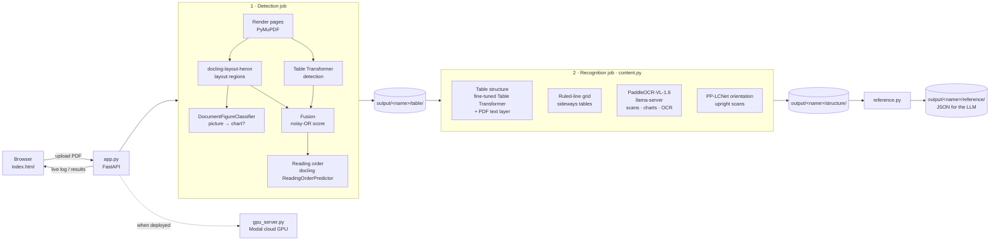

# TableLens — PDF Document Parser

Finds and reads the tables, charts and text in financial PDFs (annual reports, 10-K / 10-Q / 20-F, interim
accounts — native, scanned or mixed). Upload a PDF in the web UI, watch a live log, and get back boxes on every
page plus structured JSON: table grids with cell text, chart data as tables, and every text region in reading order.
For medical lab reports it also reads every test with its result, unit, reference range and flag (`medical.py`).

This pipeline is the parsing layer for **AEIDS**, the multi-agent analysis system being built on top of it — see
`CLAUDE.md` and `docs/` (`ARCHITECTURE.md`, `MVP_PLAN.md`, `DECISIONS.md`).

## Quick start

```bash
git lfs install                       # once per machine, BEFORE cloning (the fine-tuned model is in Git LFS)
git clone https://github.com/Numaa-droid/PDF-Document-Parser.git
cd PDF-Document-Parser
pip install -r requirements.txt       # Python 3.11
python download_models.py             # pre-downloads every Hugging Face model (several GB, one time)
python app.py                         # self-check, then http://127.0.0.1:8000
```

Scanned tables and charts need **llama-server** (llama.cpp) on `PATH` — it serves PaddleOCR-VL-1.6 and is
started automatically on first use (`winget install llama.cpp` on Windows). Without it, native PDFs still work.

Other ways to run it:

| Where | Command |
|---|---|
| Docker (GPU, everything baked in) | `docker compose up -d --build` → http://127.0.0.1:8000 |
| Docker, CPU only | see the `--build-arg` line at the top of the `Dockerfile` |
| Cloud GPU (Modal) | `pip install modal && modal setup`, then `python -m modal deploy gpu_server.py`; `python app.py` then sends jobs there |

The UI has no login — keep it bound to `127.0.0.1`.

## Architecture



### 1 · Detection (`app.py`)

Two learned models, no hand-written layout rules:

- **microsoft/table-transformer-detection** proposes tables at a low threshold (high recall).
- **docling-project/docling-layout-heron** labels every region on the page: table, paragraph, heading, list
  item, caption, picture, header / footer, …
- **Fusion:** a table is a region the layout model calls a table. When Table Transformer boxes the same region
  too, the confidence goes up (noisy-OR of both scores). Table Transformer boxes over text, lists or pictures are
  reported as *rejected*.
- **Charts:** docling's **DocumentFigureClassifier** checks each picture. Bar, line, pie, scatter and box plots
  become `chart` regions.
- Text regions take their text from the PDF text layer. **Reading order** comes from docling's
  ReadingOrderPredictor: page header, then the body column by column, then page footer. Each table is linked to the
  heading just before it (its title).

### 2 · Recognition (`content.py`, started from the UI on a finished detection)

| Content | How it is read |
|---|---|
| Native table | **Fine-tuned Table Transformer** (`models/tatr-finetuned-01-11`) reads the grid (rows, columns, spanning cells, headers). Each PDF word goes into the cell it overlaps most. The original v1.1-all model takes over when its views agree more clearly. |
| Sideways table | Turned upright first. If it has ruling lines, the grid comes from those lines (`structure_tatr.ruled`). |
| Scanned table (no text layer) | **PaddleOCR-VL-1.6** at 216 dpi, after **PP-LCNet_x1_0_doc_ori** turns the page upright |
| Chart | PaddleOCR-VL-1.6 `Chart Recognition:` → data saved as a table (`chart_table`) |
| Other regions (mode "all") | Text from the PDF text layer; scans are OCR'd by PaddleOCR-VL |

Results are saved to `output/<name>/structure/`. **`reference.py`** then converts them into the reference
JSON the LLM reads (`output/<name>/reference/`), schema `medical-report/1.0`: report metadata and dates, sections
per panel, every text region in reading order, every table as a full grid (cell types, numeric values, column
roles), and every lab test with its result, unit, reference range and flag (`medical.py`). Every value keeps its page
and box in PDF points. Patient names and ids are redacted by default (`--keep-identifiers` keeps them).
The JSON Schema file it validates against (`schema/medical-report.schema.json`) is not in the repo yet, so that check
is skipped.

### Where jobs run

`app.py` sends detection and recognition to the **Modal GPU server** (`gpu_server.py`, A10G / L4, models baked into
the image) when it is deployed and reachable. Otherwise jobs run on the local CPU. One job runs at a time.

## Models

| Model | Used for | Comes from |
|---|---|---|
| `models/tatr-finetuned-01-11` | Table structure (main) | This repo, Git LFS |
| microsoft/table-transformer-structure-recognition-v1.1-all | Table structure (fallback, base of fine-tune) | Hugging Face |
| microsoft/table-transformer-detection | Table detection | Hugging Face |
| docling-project/docling-layout-heron | Page layout regions | Hugging Face |
| docling-project/DocumentFigureClassifier-v2.5 | Chart vs picture | Hugging Face |
| PaddlePaddle/PaddleOCR-VL-1.6-GGUF | Scans, charts, OCR | Hugging Face (served by llama-server) |
| PP-LCNet_x1_0_doc_ori | Page orientation | PaddleOCR, downloads on first use |

`python download_models.py` fetches all the Hugging Face models ahead of time. Without it, each one downloads on first use.

Fine-tuned model on the held-out test reports: rows right 82.7 %, columns right 82.7 %, cell adjacency F1 94.0 %,
perfect tables 75.3 %.

## Files

| File | Role |
|---|---|
| `app.py` | FastAPI server + detection pipeline + job runner; UI at `/` |
| `index.html` | The web UI |
| `content.py` | Recognition: table structure, charts, OCR, reading order |
| `detect.py` | Table Transformer detection → COCO JSON |
| `structure_tatr.py` | Table Transformer structure recognition (+ upright / ruled-line handling) |
| `structure.py` | TableFormerV2 via ONNX Runtime (earlier structure model, kept for comparison) |
| `reference.py` | Recognition result → reference JSON (`medical-report/1.0`); `compare` scores two reference JSONs |
| `medical.py` | Lab tables → one record per test (result, unit, reference range, flag, method, specimen) |
| `CLAUDE.md`, `docs/` | AEIDS design: architecture, Release 0 plan, decision log |
| `gpu_server.py` | Modal cloud-GPU deployment of the whole pipeline |
| `spotting_check.py` | Experiment: PaddleOCR-VL "Spotting" on scanned tables |
| `download_models.py` | Pre-downloads every Hugging Face model |
| `test_recognise.py` | Fast check of the recognition job with models stubbed (`python test_recognise.py`) |
| `Dockerfile`, `docker-compose.yml` | Container with llama.cpp + all models baked in |

Not in the repo (git-ignored): `doc/` (input PDFs), `output/`.
